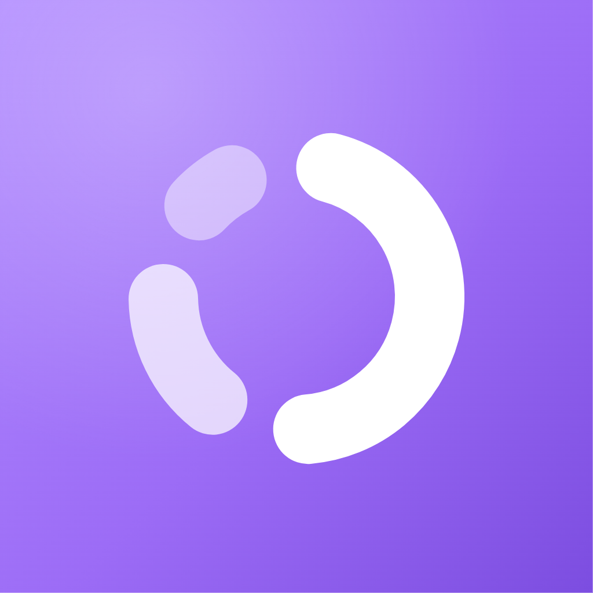
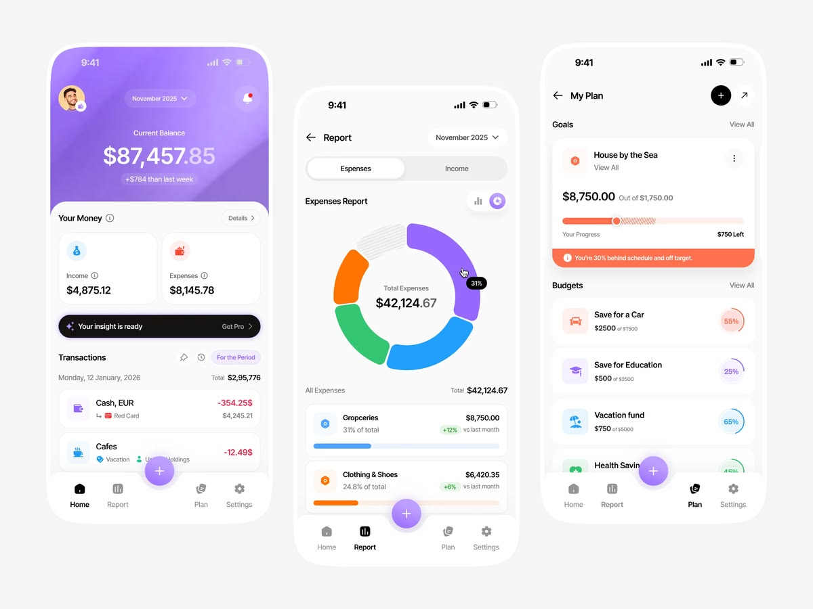

<div align="center">



# Floos

**Your money, private and offline.**<br/>
A personal finance tracker for expenses, incomes, transfers, budgets, goals, recurring bills and debts.<br/>
Built with Flutter, with an encrypted local database and no account, no cloud and no ads.

<br/>


<br/>

[Features](#features) · [Design](#design) · [Architecture](#architecture) · [Getting started](#getting-started) · [Roadmap](#roadmap)

<br/>



</div>

---

## Why Floos?

Most finance apps want your data in their cloud. Floos keeps everything **on your phone**: an
encrypted SQLite database that you can back up, restore, export and delete whenever you want.
Money is stored as integer cents (never floating point), and balances are always computed from
your transactions, never stored.

## Features

| | |
|---|---|
| ⚡ **Quick add in 5 seconds** | Tap the **+** button, type the amount on the built-in calculator keypad (`45+12,5`), pick a category, then Save. Undo is one tap away. |
| 💳 **Accounts & transfers** | Cash, bank, cards, savings, e-wallets, in any currency, with manual exchange rates, reconcile, and running balance on every row. |
| 📊 **Reports** | A donut or bar chart by category with subcategory roll-up, trend versus the previous period, cash flow over 12 months, stats, breakdowns by tag and by account, plus CSV and PDF export. |
| 🎯 **Budgets** | Weekly, monthly, yearly or custom limits, with rollover, rings that turn green, orange then red, remaining amount per day, a projection, and alerts at 80 % and 100 % (sent once per period). |
| 🏠 **Goals** | Savings objectives with a deadline, an "on track" or "behind" banner, the amount needed per month, linked savings accounts, milestones at 25, 50, 75 and 100 %, and confetti 🎉 when you reach one. |
| 🔁 **Recurring & bills** | Daily, weekly, monthly or yearly rules: automatic or "to confirm", catch-up after months offline, short months handled (the 31st becomes the 28th or 29th), and bill reminders. |
| 🤝 **Debts & loans** | "I owe" and "Owed to me", partial payments, overdue flag and automatic settlement. |
| 💡 **Local insights** | "Food is at 86 % of its limit", "Cafes up 34 % vs last month", "You saved 22 % of your income 👏". Computed on the device. |
| 🔒 **Privacy** | PIN or biometric lock, hide-amounts mode, blurred preview in the app switcher, and no network permission. |
| 💾 **Your data, portable** | `.floos` backups (optionally AES-GCM encrypted with a password), automatic backups with rotation, a CSV import wizard and CSV export. |
| 🔔 **Notifications** | Budget alerts, bills, debts, goals and a daily reminder, plus an in-app notification center. |
| 📱 **Home-screen widgets** | Spent this month, quick add, balance and your top budget. |

## Design

The UI follows [`design.md`](design.md), based on the reference image above. It uses a soft
lavender style with one purple brand colour, white cards on a light grey background, a center
gradient **+** button, decimals shown at 50 % opacity, and full light and dark themes.

| Token | Value |
|---|---|
| Brand purple | `#9C6CF6` |
| Font | Inter (bundled, no runtime fetching) |
| Card radius | 20 pt |
| Spacing grid | 4 pt |

## Architecture

```text
lib/
  core/        theme tokens · shared widgets · money (int minor units) · time (local days, periods) · l10n
  data/        Drift tables & DAOs · FTS5 search · encrypted connection · repositories (Result<T>)
  domain/      pure Dart services: balances, budgets, goals, recurring, debts, FX, insights, reports, backup, CSV
  app/         providers · notifications · alerts · home widget sync · side effects
  features/    home · transactions · transaction_form · report · plan · goals · budgets · recurring · debts · settings …
```

- **State:** Riverpod · **Navigation:** go_router · **DB:** Drift + SQLite3MultipleCiphers (SQLCipher mode)
- **Charts:** fl_chart + custom painters (donut, rings, hatched bars)
- **Spec-driven:** built with [GitHub Spec Kit](https://github.com/github/spec-kit). See
  [`.specify/memory/constitution.md`](.specify/memory/constitution.md) and
  [`specs/001-floos-finance-app/`](specs/001-floos-finance-app/).

## Getting started

```bash
git clone https://github.com/Laktab-Noureddine-code/floos.git
cd floos
flutter pub get
dart run build_runner build --delete-conflicting-outputs   # Drift code generation
flutter gen-l10n                                           # French strings
flutter test test/domain test/data                         # unit & repository tests
```

> ⚠️ The app is still a work in progress and does not run end to end yet.
> See [`STATUS.md`](STATUS.md) for exactly what is done and what remains.

## Roadmap

- [x] Spec Kit constitution, spec, plan, data model, contracts, tasks
- [x] Encrypted database, repositories, full-text search
- [x] Domain services with ~105 tests (money, periods, budgets, goals, recurring, backup, CSV…)
- [x] Design system & shared components, logo
- [x] Transaction form & Home tab
- [ ] App shell & navigation, onboarding, lock screen
- [ ] Report, Plan (goals, budgets, recurring, debts) and Settings screens
- [ ] Backup / restore / CSV import screens, notification center
- [ ] Android & iOS home widgets, platform setup
- [ ] Widget, golden and integration tests

---

<div align="center">
<sub>Made with 💜 in Morocco · Your data never leaves your device.</sub>
</div>
